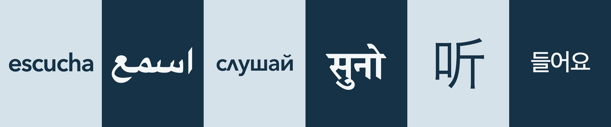

# Hear the chapter you are studying



Fluency takes lots and lots of meaningful, interesting communication. You listen and watch. Then, when you are ready, you mimic. Then you improvise, with more skill and less guesswork.

I started this project because the ancient languages I study have very little of that. For Latin, I scraped the internet and found 460 hours of spoken audio. I did not need more grammar. I needed more *Hebdomada Papae* at my level, and *Hebdomada* was past it. These skills make it so you can take the transcripts of _Hebdomada_ and create a simpler dialogue or repot, one that's at your level. Or take the current of _LLPSI_ that you're on and create engaging conversation to listen to, whether to prime yourself or to reinforce and expand what you've learned in that chapter.

I am building this for ancient languages. The same steps work for modern ones.

### Languages tested

- [ ] German
- [ ] Hebrew
- [ ] Italian
- [ ] Koine Greek
- [ ] Modern Greek
- [ ] Spanish (in progress)
- [x] Latin

## 1. The problem

You want a new language to make sense when someone speaks it. The chapter in front of you has this week's story and the words that carry it. Reading the page once leaves those words on the page.

Understanding grows when you hear the same ideas spoken, simply, more than once. A teacher asks a short question. You answer. They ask again from another angle. The new words come back until your ear knows them. Teachers call this TPRS: Teaching Proficiency through Reading and Storytelling. Asking about one idea several ways is called circling.

A class might circle a story once, out loud, and then move on. Building that same spoken practice for the exact chapter on your desk, matched to how far along you are, usually means writing the questions and recording them yourself.

## 2. The solution

Hand over the chapter you are already reading. Get back a short spoken dialogue.

One voice is the teacher. One voice is the learner. They tell the story from your chapter in short lines, then circle it: the same facts return as easy choices, so you can follow when a word is still new. The result is one audio file. Play it on a walk, in the car, or with the book open beside you.

Any language the chapter is written in can be the language you hear.

If you want the chapter itself instead, there is a second path: an audiobook. One voice reads your text as written. Nothing is expanded or circled. You can ask for the text to be simplified to a level first, but only if you want that.

## 3. How this gets you there

You talk to an AI assistant the way you would ask a person for help. Claude, Codex, Gemini, and Grok can all follow the steps in this project. You give it the chapter. It does five things:

1. Cleans up the text, including a messy scan.
2. Writes the teacher-and-learner dialogue at your level, from brand new to advanced.
3. Checks the language, and checks that the questions really circle.
4. Prepares the script so it can be spoken aloud.
5. Records two voices and saves an mp3.

You hear a few lines before the full recording. If the voices sound right, the rest is made. That sample is there so you can pick different voices while the recording is still short.

You answer a few plain questions along the way: go straight through, or pause so you can read each step; how far along you are; and the word your language uses for "or" (Latin uses *an*).

When it finishes, you have a folder with the cleaned chapter, the written dialogue, and the audio.

The audiobook path is shorter. It cleans the text (skipped if it is already reliable), optionally simplifies it to a level you pick, adds pauses for a natural read, and records one narrator voice. The same rule applies: you hear a few lines first, and the full recording waits for your yes. Pick the voice model if you like; it defaults to `eleven_v4`.

## 4. Technical details

The sections above are the whole idea. Everything below is how to set it up, and how the pieces fit if you want to change them.

The project name is Second Language LLM TPRS. The steps are instructions an assistant reads from this repo. Shared rules live in `AGENTS.md`.

### What you need

- Python 3. The scripts use the standard library only.
- `ffmpeg` on your `PATH`.
- An ElevenLabs subscription. Set `ELEVENLABS_API_KEY` in the shell you start the assistant from. Keep the key out of the chat. If it shows up there, rotate it.
- An assistant that reads `AGENTS.md` and skill folders: Claude Code, Codex, Gemini CLI, or Grok.

### Getting started

You bring the chapter: paste it into the chat, or point the assistant at a text file.

1. Fork and clone the repo, then open a terminal in the project folder.
2. In that same terminal, set your key: `export ELEVENLABS_API_KEY=...`
3. Pick two ElevenLabs voices, teacher and learner, and note their voice IDs. For the audiobook, pick one narrator voice. Save them in `tprs.config.json` (see [Config](#config)), or give them to the assistant when it asks.
4. Have the chapter as text you can paste, or as a `.txt` file outside the repo or under `output/` (that folder is gitignored). A PDF works when your assistant can read PDFs. A scanned PDF needs OCR first, so the words are real text.
5. Start the assistant in the project folder.
6. Ask it to run the pipeline. For example:

   > Run the tprs-pipeline on ~/Downloads/chapter3.txt. Latin, source slug `wheelock`, chapter slug `ch03-taberna`.

   For a straight reading, ask for the audiobook instead:

   > Run the audiobook-pipeline on ~/Downloads/chapter3.txt. Latin, source slug `wheelock`, chapter slug `ch03-taberna`.

   The source slug is a short name for the book. The chapter slug is a short name for this chapter. They become the folder names.

7. Answer the setup questions: full auto or approve each stage, your [ACTFL](https://www.actfl.org/educator-resources/actfl-proficiency-guidelines) level (Novice, Intermediate, or Advanced, and Low / Mid / High inside those), and the language's word for "or". (The audiobook asks whether to simplify the text, and to which level, instead of the "or" word.)
8. Listen to `test-4lines.mp3` when the assistant stops. Confirm, and it writes `dialogue.mp3` (`reading.mp3` for the audiobook). Full-auto mode still waits on this clip, because the full recording spends ElevenLabs credits.

Files land in `output/<source-slug>/<chapter-slug>/`. To continue later, ask the assistant to run the next stage on that folder. You can also name one stage, for example: proofread `output/wheelock/ch03-taberna/dialogue.txt`.

### Skills

Project skills live in `.agents/skills/`. Codex, Grok, and Gemini CLI load that directory. Claude Code loads the same folders through the `.claude/skills` symlink.

| Skill | What it writes |
| --- | --- |
| `clean-source-text` | `original.txt` |
| `tprs-expand` | `dialogue.txt`, at the ACTFL level you chose |
| `proofread-dialogue` | edits `dialogue.txt` in place |
| `format-for-elevenlabs` | `dialogue.elevenlabs.txt` |
| `generate-dialogue-audio` | `test-4lines.mp3`, then `dialogue.mp3` after you confirm |
| `tprs-pipeline` | runs the five in order |
| `adapt-reading-level` | `adapted.txt`, only if you want the text simplified |
| `format-for-narration` | `reading.elevenlabs.txt` |
| `generate-reading-audio` | `test-4lines.mp3`, then `reading.mp3` after you confirm |
| `audiobook-pipeline` | a straight one-voice reading: clean, optional level change, format, audio |
| `write-course-script` | `script.jsonl` for one picture-course lesson, from the Course-Builder-Kit |
| `proofread-course-script` | edits `script.jsonl` in place |
| `design-course-pictures` | `pictures.json` and `style.md` |
| `generate-course-images` | `cast.png`, `sheet-01.png` for you to confirm, then all sheets and `pictures/` |
| `generate-course-audio` | `test-4lines.mp3`, then one clip per sentence in `audio/` after you confirm |
| `export-course-to-app` | copies the lesson into the `app/` web player |
| `course-pipeline` | a Winitz/Buth picture course lesson: script, pictures, audio, web player |

The course pipeline needs the Course-Builder-Kit folder beside this repo (`../Course-Builder-Kit`) (or `COURSE_BUILDER_KIT` set to its path). Pictures come from Gemini (`GEMINI_API_KEY`), else Grok (`XAI_API_KEY`), else you paste the prompts into any image tool yourself. Six pictures are drawn per image as a 3x2 grid, then cut apart with ffmpeg. The player lives in `app/` and needs Node 22: `cd app && npm install && npm run dev`, then open http://localhost:8080.

### Config

Copy `tprs.config.example.json` to `tprs.config.json` (gitignored). Fill in voice IDs per language (`narrator_voice_id` is for the audiobook pipeline), or let the audio step ask and save them. The file holds voice IDs and the default voice model (`eleven_v4`). The API key stays in the environment.

### Output

```
output/<source-slug>/<chapter-slug>/
  original.txt
  dialogue.txt
  dialogue.elevenlabs.txt
  test-4lines.mp3
  dialogue.mp3
  adapted.txt            (audiobook, optional)
  reading.elevenlabs.txt (audiobook)
  reading.mp3            (audiobook)

output/course-<language>/L1-01/
  script.jsonl pictures.json style.md cast.png
  sheets/  pictures/  audio/  test-4lines.mp3
```

### Scripts

```bash
python3 scripts/tprs_config.py show --language latin
python3 scripts/format_dialogue.py IN OUT --or-word an
python3 scripts/tprs_audio.py IN.txt OUT.mp3 --language latin --limit 4
python3 scripts/tprs_config.py show --language latin --mode reading
python3 scripts/format_dialogue.py IN OUT --reading
python3 scripts/tprs_audio.py IN.txt OUT.mp3 --language latin --mode reading --limit 4
python3 scripts/course_pictures.py plan LESSON/script.jsonl LESSON
python3 scripts/course_pictures.py render LESSON --sheet 1
python3 scripts/course_pictures.py cut LESSON
python3 scripts/tprs_audio.py LESSON/script.jsonl LESSON/audio --language latin --mode course --limit 4 --join LESSON/test-4lines.mp3
python3 scripts/export_course.py LESSON --language latin --lesson 1
```

The audiobook sends one request per line, so keep paragraphs short. A line over the model's character limit fails.

### Tests

```bash
python3 -m unittest discover -s tests -v
cd app && npm test && npm run typecheck
```

Pull requests into `main` must pass the `tests`, `gitleaks`, `codeql`, and `dependency-review` checks. Report vulnerabilities through [Security Advisories](https://github.com/cameronenochs/second-language-llm-tprs/security/advisories/new).

### Later

Remembering words and grammar across chapters, so a later lesson can circle what an earlier one taught, is left for a later version.

## License

MIT
